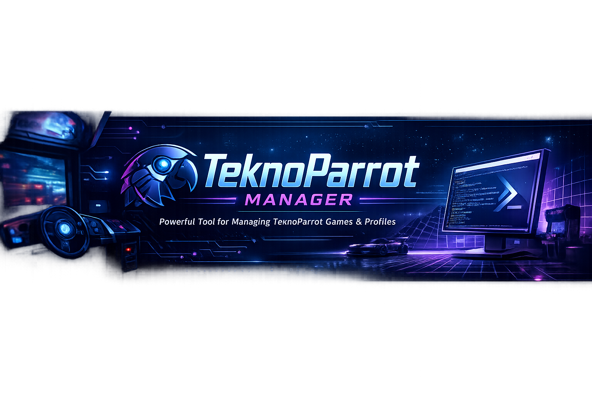
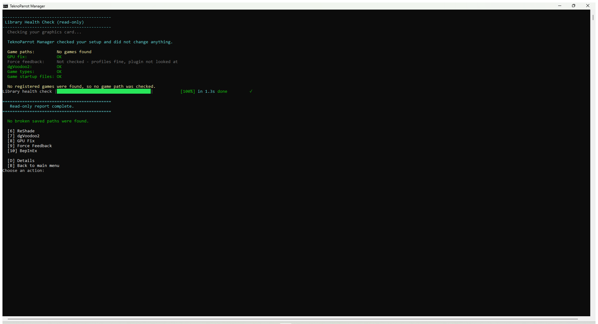

# TeknoParrot Manager

TeknoParrot Manager is a Windows PowerShell tool for managing TeknoParrot arcade libraries on Windows. It registers extracted games, propagates controls, deploys lightgun crosshairs, applies ReShade and dgVoodoo2 compatibility fixes, and exports libraries to LaunchBox.

Canonical links: [GitHub repository](https://github.com/Jumpstile/teknoparrot-manager) | [Releases](https://github.com/Jumpstile/teknoparrot-manager/releases) | [Issue tracker](https://github.com/Jumpstile/teknoparrot-manager/issues)

> **This page describes v1.0 RC8.3.** RC8.3 is the latest published release. It is a fix-up release for RC8.2, the previous published release. If you use RC8.2, choose Check for Updates (menu 15) to get RC8.3. Earlier published releases are v1.0 RC8.1 and RC7. The final v1.0 RC9 comes later. RC8 was a tester build and was never published. RC8.1 is the first version that can update itself in place (see Check for Updates). The changes since RC8.2 are listed in `TeknoParrot-Manager-CHANGELOG.txt`. Final Version 1.0 remains unpublished. AutoSync backs up UserProfiles before extraction; preview mode skips the backup. Test one game after each run.

**Jump to:** [Quick Start](QUICKSTART.md) | [Full user guide](docs/USER-GUIDE.md) | [Changelog](TeknoParrot-Manager-CHANGELOG.txt) | [Troubleshooting](docs/TROUBLESHOOTING.md) | [Start Here (first game in 10 minutes)](docs/START-HERE.md)

## Download

Release page of the latest published release: [v1.0 RC8.3](https://github.com/Jumpstile/teknoparrot-manager/releases/tag/v1.0-RC8.3). The previous published release is [v1.0 RC8.2](https://github.com/Jumpstile/teknoparrot-manager/releases/tag/v1.0-RC8.2).

1. Download the ZIP file from the release page.
2. Extract the whole package to a short folder outside Program Files, for example `C:\TPM`. Keep all the folders.
3. Double-click **`TeknoParrot-Manager.bat`**.

TeknoParrot Manager does not install TeknoParrot. Install TeknoParrot first. [Start Here](docs/START-HERE.md) shows how.

Using RC7 or RC8? Those builds cannot update themselves. Install the latest release by hand once. After that, the **Check for Updates** menu item does it for you.

## What it does

These are the main things TeknoParrot Manager can do:

**Set up your games**

- **AutoSync (menu 1).** Unpacks your game ZIPs and adds the games to TeknoParrot in one run. It works from a network drive or a local folder and leaves unchanged games alone. It backs up your TeknoParrot settings (UserProfiles) first.
- **Register only (menu 2).** Adds games you already extracted. It finds each game, picks the right game path, and never overwrites a game that is already added.
- **Matches hard-to-name games.** It uses folder names, game codes and an optional community game list to work out which game is which.
- **LaunchBox export.** Writes your games straight into the LaunchBox library.

**Controls, picture and fixes**

- **Propagate Controls (menu 3).** Set up one game of each control type. TeknoParrot Manager copies those controls to similar games that have none. It never invents a binding.
- **Crosshair setup (menu 4).** Gives lightgun games custom player 1 and player 2 crosshairs.
- **ReShade setup (menu 5).** Adds picture effects (shaders) to the games you pick.
- **dgVoodoo2 setup (menu 6).** Fixes older games that crash or show a black screen on old graphics settings.
- **GPU fix setup (menu 7).** Detects AMD, NVIDIA or Intel and applies the matching fix.
- **Force feedback setup (menu 8).** Sets up the native FFB Blaster (membership) or a free third-party plugin for wheel games.
- **BepInEx setup (menu 9).** Installs or updates BepInEx for the games that need it, after you approve.
- **Region setup (menu 10).** Pick the country your games start in, choose which games, confirm, and switch back to automatic any time.
- **Postgres setup (menu 11).** Sets up the local PostgreSQL database that some Incredible Technologies games need.
- **Required game patches (menu 12).** Finds a required fix, checks it against your own ZIP, backs up first, installs it, verifies it, and can undo it.

**Check, protect and update**

- **Library health check (menu 13).** Reports what is registered, broken or missing, without changing anything.
- **Restore backup (menu 14).** Puts profiles, LaunchBox library files or Postgres databases back from an earlier copy.
- **Check for Updates (menu 15).** Downloads a new release, checks it, installs it, and puts everything back if something goes wrong. Available from RC8.1.
- **Create Support Package (menu 16).** Gathers safe logs and reports into one ZIP to attach to a bug report.

**For beginners**

- **Plain-language screens.** Short messages and one clear next step. Press **D** on a screen for the technical details.
- **Preview mode.** Shows the planned changes without making them.

The [full user guide](docs/USER-GUIDE.md) describes every feature step by step.

## Quick start

**Before you start:**

1. Install TeknoParrot into its own folder, such as `C:\TeknoParrot`. Never use the installer's default `C:\Windows\system32`.
2. Open `TeknoParrotUi.exe` yourself, one time. Click OK, OK, and Accept and Continue on the pop-up windows. You may use Skip Setup.
3. Keep your games as ZIP files (for AutoSync) or already extracted into folders.

**Your first run:**

1. Double-click **`TeknoParrot-Manager.bat`** and answer each first-run question. If you are not sure, pick the first choice.
2. At the main menu, type **1** (AutoSync) and press Enter. It unpacks your games and adds them to TeknoParrot.
3. Open TeknoParrot and start one game. Test one game after each run.
4. Stuck? Type **16** to make a support package, or see [Troubleshooting](docs/TROUBLESHOOTING.md).

The normal backup protects UserProfiles (TeknoParrot's saved game settings) only. It is not a whole-game backup.

**The main menu** (type a number and press Enter):

| # | Mode | What it does |
| --- | --- | --- |
| 1 | **AutoSync** | Extract your game ZIPs, then register the games |
| 2 | **Register only** | Register games you already extracted |
| 3 | **Propagate Controls** | Copy known controls from a game you set up to similar games that have none |
| 4 | **Crosshair setup** | Pick and deploy custom crosshairs to lightgun games |
| 5 | **ReShade setup** | Add visual post-processing to game folders |
| 6 | **dgVoodoo2 setup** | Fix some old DX8, DirectDraw, and Glide game crashes or black screens |
| 7 | **GPU fix setup** | Apply the AMD / NVIDIA / Intel fix to registered games |
| 8 | **Force feedback (FFB) setup** | Native FFB Blaster (membership) or a free third-party plugin |
| 9 | **BepInEx setup** | Install or update after you approve, using stable x64/x86 releases |
| 10 | **Region setup** | Pick the country your games start in, choose which games, confirm |
| 11 | **Postgres setup** | Set up the local PostgreSQL database some Incredible Technologies games need |
| 12 | **Required game patches** | Find, check, back up, install, verify, or undo a required fix from your local ZIP |
| 13 | **Library health check** | Report what is registered, broken, or missing, without changing anything |
| 14 | **Restore backup** | Put profiles, LaunchBox library files, or Postgres databases back from an earlier copy |
| 15 | **Check for Updates** | Check GitHub for a newer release and install it (RC8.1 and later) |
| 16 | **Create Support Package** | Gather safe logs and reports into one ZIP to send when asking for help |
| 17 | **Exit** | Quit |

The [Quick Start guide](QUICKSTART.md) has more detail on each step, and [Start Here](docs/START-HERE.md) covers the very first setup.

## Built to be safe

- Backups before anything is changed, and a one-step restore.
- A preview mode that shows the planned changes without making them.
- A free-space check and a full log of every run.
- Downloads are checked before they are used.
- A **Create Support Package** menu item that makes a safe ZIP for bug reports.

## Requirements

- A Windows PC with PowerShell 5.1 (built into Windows, no install needed).
- TeknoParrot installed with `TeknoParrotUi.exe`.
- Your own legally obtained games, as ZIP files (for AutoSync) or already extracted.

## Documentation

| Read this | When you want to |
|---|---|
| [Start Here](docs/START-HERE.md) | Add your first game in about 10 minutes |
| [Quick Start](QUICKSTART.md) | See the main menu and the usual steps on one page |
| [Full user guide](docs/USER-GUIDE.md) | Look up any feature, menu option or setting |
| [Troubleshooting](docs/TROUBLESHOOTING.md) | Fix the ten most common beginner problems |
| [Changelog](TeknoParrot-Manager-CHANGELOG.txt) | See what changed in each release |
| [Check for Updates](docs/AUTO_UPDATE.md) | Learn how in-place updating works |
| [Compatibility checklist](docs/Compatibility.md) | Use the short checklist for tester notes |
| [Advanced users](docs/ADVANCED-USERS.md) | Use TeknoParrot Manager as a repeatable tool for cabinets and frontends |
| [Roadmap](ROADMAP.md) | See what is planned |
| [Wiki](https://github.com/Jumpstile/teknoparrot-manager/wiki) | Read the short guides for each feature |

## Getting help

Found a problem? Choose **Create Support Package** in TeknoParrot Manager and attach the ZIP it makes to a new issue on the [issue tracker](https://github.com/Jumpstile/teknoparrot-manager/issues). It collects safe diagnostics automatically. See [Contributing](CONTRIBUTING.md) and [Security](SECURITY.md).

## What it does not do

- It does not invent control bindings. A control is set only when a game you already set up has it.
- It does not provide game files. You must own or otherwise have lawful rights to the original arcade PCB and any ROM or game data you use. TeknoParrot Manager does not provide, distribute, or endorse unauthorized game files.

## License

TeknoParrot Manager is source-available under the [TeknoParrot Manager Source-Available Personal/Non-Commercial License](LICENSE). Official releases may be used personally and non-commercially. Issue reports and pull requests are welcome for consideration. Commercial use, redistribution, modified distribution and similar uses need prior written permission. See [COMMERCIAL-LICENSE.md](COMMERCIAL-LICENSE.md). The TeknoParrot Manager name and branding are reserved.