# Start here: from no setup to your first game

TeknoParrot Manager adds games you own to TeknoParrot. It also helps copy controls and apply supported fixes.

It is not TeknoParrot. It does not install or set up TeknoParrot itself.

Allow about 10 minutes for TeknoParrot Manager setup and your first small game, once the downloads are ready. Installing TeknoParrot, downloading updates, extracting large games, and setting up a wheel or lightgun can take longer.

This guide describes v1.0 RC9.2. If your menu looks different, follow the menu names.

Each step below has one action. "You will see" tells you what should appear. "Next" tells you what to do after that.

## 1. What you need

- A Windows PC that has PowerShell 5.1 (a text-command program built into Windows) available for TeknoParrot Manager.
- Internet access for TeknoParrot, its updates, and optional downloads.
- Your own legally obtained game files, with enough free disk space to extract them.
- A keyboard, controller, wheel, or lightgun for the games you want to play.
- A short folder you can save files in for each program, and a separate folder for games.

Example folders in this guide are suggestions, not paths you must use:

- `C:\TeknoParrot` for TeknoParrot.
- `C:\TPM` for TeknoParrot Manager.
- `C:\Games` for extracted games.
- `C:\GameZIPs` for your original ZIP files, if using AutoSync.

TeknoParrot Manager never provides, downloads, or links to games, ROMs, or patch files. You must own the game data you use, or have the legal right to use it.

The optional Eggman collection [DAT](#dat) is a list of game names, not a game download. Game Notes are documentation, not a source of game files.

Stuck? See [Troubleshooting](TROUBLESHOOTING.md).

### More detail

- The short-folder advice matters most for games that cannot handle long folder paths.
- Official sources checked on 2026-10-31 are listed in section 2.

## 2. Install TeknoParrot by hand first

TeknoParrot Manager does not install TeknoParrot. You install it first, with TeknoParrot's own installer.

1. Open the [official download page](https://teknoparrot.com/en/Home/Download).

   You will see: the stable installer and a separate experimental UI offer.

   Next: use the stable installer.

2. Click **Download TeknoParrot Installer** for the stable release.

   You will see: a ZIP file in your browser's download location.

   Next: open File Explorer and find that ZIP.

3. In File Explorer, right-click the downloaded ZIP and choose **Extract All**. Pick a short folder you can write to.

   Extract first. Do not run the installer from inside the ZIP.

   You will see: the extracted installer outside the ZIP.

   Next: open the extracted folder.

4. Open the extracted folder.

   You will see: `TeknoParrotInstaller.exe`.

   Next: run it.

5. Run **TeknoParrotInstaller.exe**.

   You will see: a window called **TeknoParrot Installer** with a folder path box, a **Cores** list, **Download Selected**, and **Full Install (Download All)**. A console window may also open behind it.

   Next: read the warning in step 6 before you click anything.

   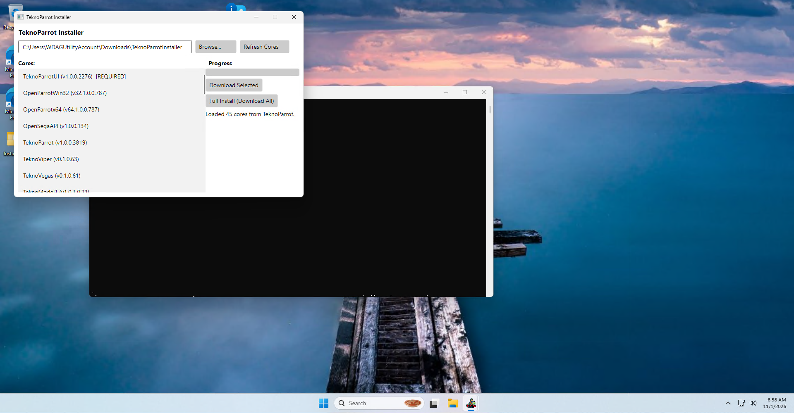

6. **Warning:** the folder path box does not start on a folder you chose. Never install into the folder it shows. Click **Browse...**.

   You will see: a folder chooser.

   Next: make a new empty folder in step 7.

7. Click **New folder** and make a dedicated empty folder with a short path and no spaces, such as `C:\TeknoParrot`. Do not use Program Files.

   Files go directly into this folder, with no extra subfolder.

   You will see: your new folder in the path box.

   Next: choose what to download.

   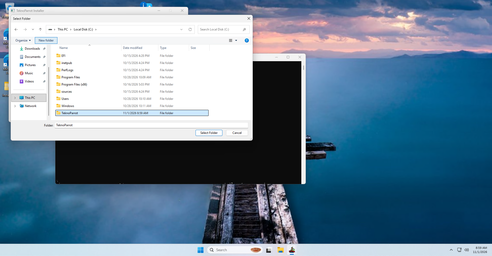

8. Click the **TeknoParrotUI (v...) [REQUIRED]** row so it turns blue.

   You will see: the row highlighted in blue.

   Next: click **Download Selected**. If nothing is selected, Download Selected does nothing.

9. Click **Download Selected**.

   You will see: the progress bar and a status line like `TeknoParrotUI: 3%`.

   Next: wait for the download to finish.

   ![The TeknoParrotUI [REQUIRED] row selected and the progress bar partway through the download](images/03-installer-core-selected.png)

10. Wait for `TeknoParrotUI: 100%`.

    You will see: `TeknoParrotUi.exe` and a `GameProfiles` folder (plus other files and folders) directly in your chosen folder.

    Next: remember that folder's path. You need it for TeknoParrot Manager.

    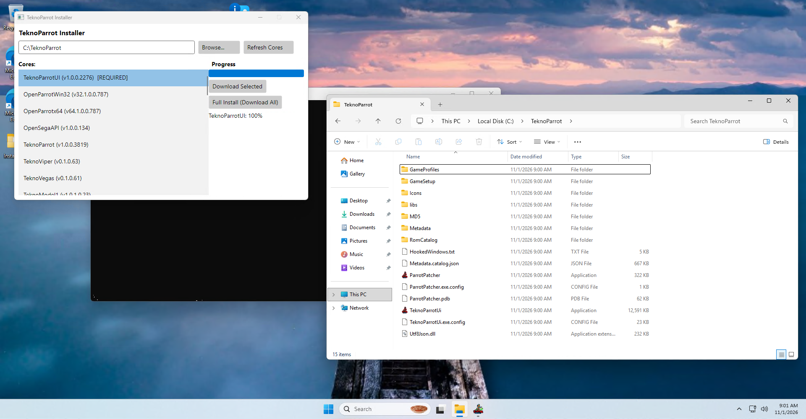

11. Optional: **Full Install (Download All)** downloads all 45 cores in the list. Its download size was not measured. You do not need it to start.

    You will see: nothing new if you skip it.

    Next: go back to the official download page.

12. On the official download page, find the **Recommended Software** section.

    You will see: DirectX End-User Runtimes (June 2010) and Visual C++ Redistributable Runtimes All-in-One.

    Next: install both, one at a time. Older games need them.

13. Install DirectX End-User Runtimes (June 2010). Follow the instructions on the linked package.

    You will see: the runtime installer's result.

    Next: fix any error before you continue.

14. Install Visual C++ Redistributable Runtimes All-in-One. Follow the instructions on the linked package.

    You will see: the runtime installer's result.

    Next: fix any error before you continue.

Antivirus note: your security program may flag TeknoParrot by mistake (a false alarm). Do not ignore a warning, because it can also be real.

- Read what was detected first.
- Only consider an exception for the TeknoParrot folder, and only for a copy from the official site that you trust.
- Never turn off protection for the whole PC. Never exclude your Downloads folder.
- An exception is not proof that a file is safe.

Stuck? See [Antivirus blocks a file](TROUBLESHOOTING.md#6-antivirus-blocks-a-file) or [PowerShell is blocked](TROUBLESHOOTING.md#7-powershell-is-blocked).

### More detail

- Official sources checked on 2026-10-31: [current download page](https://teknoparrot.com/en/Home/Download) and [legacy getting-started guide](https://teknoparrot.com/wiki/getstarted.html).
- The steps were checked on 2026-10-31 with the stable installer `TeknoParrotInstaller_2.0.0.11.zip` and TeknoParrotUI 1.0.0.2276. The test ran in a clean Windows Sandbox (a throwaway copy of Windows).
- Later versions may look different. The legacy guide describes an older flow, so its screens do not match these steps.
- After you extract the ZIP, the folder path box shows the installer's own folder, for example `C:\Users\<you>\Downloads\TeknoParrotInstaller`. If you run the installer from inside the ZIP, it can show `C:\Windows\system32`. Never install into either.
- The official page recommends the two runtimes. They supply components older games need. Having a newer DirectX version alone does not replace the legacy runtime.
- During the 2026-10-31 check no runtime request appeared, but that was a clean test PC, so still install them.
- The current official download page does not specify a .NET version or a minimum Windows version. Do not install a guessed .NET version based on an experimental release name.
- If Windows or TeknoParrot asks for a runtime, follow that specific message and the publisher's instructions.
- The legacy official guide warns about false positives and recommends an exception for the TeknoParrot folder.

## 3. Open TeknoParrotUI once

TeknoParrot needs to run once by itself, so it can set itself up.

A game setup file tells TeknoParrot which program file (the .exe) and which settings a game needs. TeknoParrot calls it a [profile](#profile). TeknoParrot Manager reads the ready-made setup files in the `GameProfiles` folder to match your games. The installer puts `GameProfiles` in your TeknoParrot folder.

Your own settings for each game are saved in TeknoParrot's saved game settings folder ([UserProfiles](#userprofiles)).

Close TeknoParrotUI before TeknoParrot Manager changes UserProfiles.

1. Double-click **TeknoParrotUi.exe** yourself.

   You will see: an **Information** box saying this is the first time you are running TeknoParrotUI.

   Next: click **OK**.

   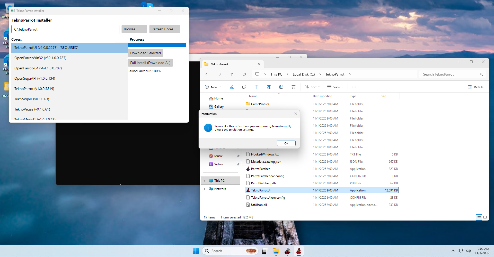

2. Click **OK**.

   You will see: a **Privacy Notice** box.

   Next: read it.

3. Read the notice and click **OK**.

   You will see: an **Updated Policies** box with **Accept and Continue** and **Quit**.

   Next: click **Accept and Continue**. (**Quit** closes TeknoParrotUI instead.)

   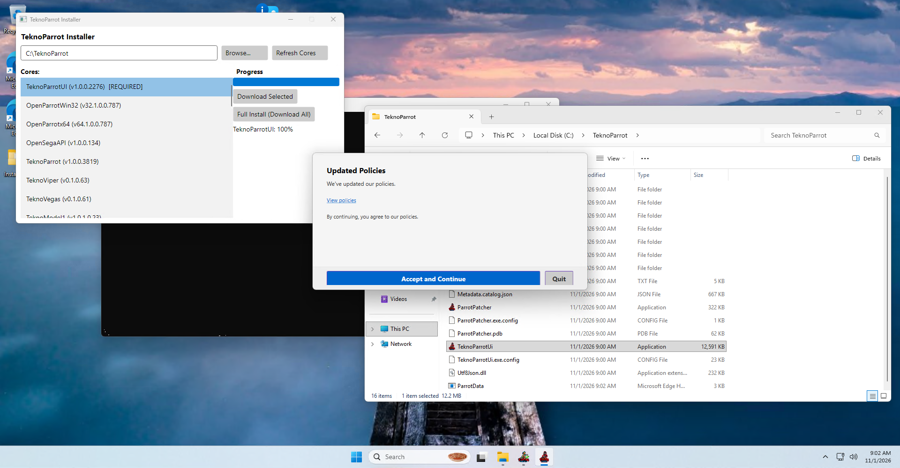

4. Click **Accept and Continue**.

   You will see: a setup wizard with **Skip Setup**, **Back**, and **Next**.

   Next: as a beginner, skip the wizard.

   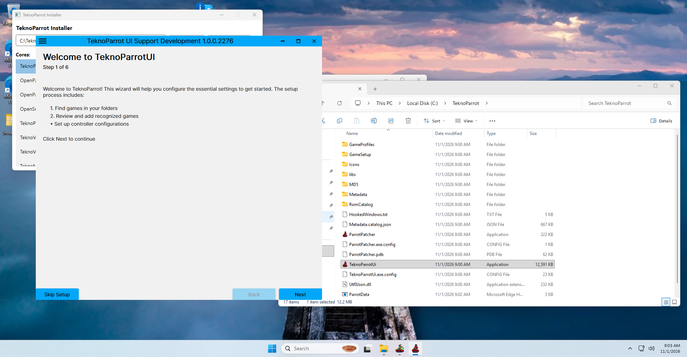

5. Click **Skip Setup**.

   You will see: the question **Are you sure you want to skip the setup?**

   Next: click **Yes**.

6. Click **Yes**.

   You will see: TeknoParrotUI's main window with a search box, Genre and Platform filters, an empty game list, and buttons such as **PLAY**, **CONTROLLER SETUP**, and **VERIFY**. If the wizard shows its last step instead, click **Finish**.

   Next: close TeknoParrotUI.

   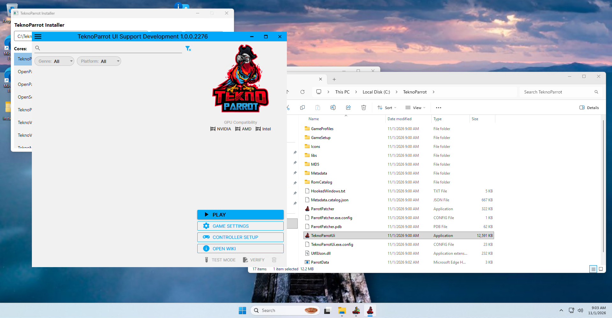

7. Close TeknoParrotUI.

   You will see: TeknoParrotUI is closed.

   Next: go to section 4.

Keeping TeknoParrot up to date is your job, not TeknoParrot Manager's. TeknoParrot Manager does not update TeknoParrot, does not check whether the setup files in `GameProfiles` are current, and never opens TeknoParrotUI for you.

Stuck? See [Missing or old profiles](TROUBLESHOOTING.md#3-teknoparrot-profiles-are-missing-or-old).

### More detail

- The wizard has 6 steps: Welcome, Scan for Games, Configure Controls, Account Login, Register Serial, and Setup Complete.
- Instead of skipping the whole wizard, you may skip only steps 2 to 5. Account Login and Register Serial can be skipped. Click **Finish** on the last step.
- TeknoParrotUI has its own game scanner (wizard step 2) and multi-game control setup (step 3). You can use them, TeknoParrot Manager, or both.
- TeknoParrot Manager adds: extracting games from your own ZIPs, DAT-based matching, copying controls between games, GPU fixes, patches, and LaunchBox export.
- The 2026-10-31 check saw no "Hello World" box, no update pop-ups, and no Windows permission (UAC) prompt. The legacy guide's Hello World and update steps describe an older flow.
- What was verified: the installer delivers TeknoParrotUI, including `GameProfiles`. How TeknoParrotUI updates itself later, and re-running the installer over an existing folder, were not verified.
- UserProfiles holds the registered games' executable paths, controls, and per-game settings as XML files.

## 4. Get TeknoParrot Manager

1. Open the [TeknoParrot Manager releases page](https://github.com/Jumpstile/teknoparrot-manager/releases).

   You will see: the latest published release and its downloadable files.

   Next: download the complete package.

2. Download the complete release ZIP, not just the `.ps1` script.

   If you were given a package for testing, use that complete supplied package instead.

   You will see: one TeknoParrot Manager package ZIP on disk.

   Next: extract it.

3. In File Explorer, use **Extract All** to extract the whole package to a short folder you can write to, such as `C:\TPM`.

   Keep its `scripts`, `tools`, and other supplied folders together.

   You will see: `TeknoParrot-Manager.bat` and `TeknoParrot-Manager.ps1` together with the supplied folders, outside the ZIP.

   Next: start the program.

4. Double-click **TeknoParrot-Manager.bat**.

   You will see: a PowerShell window with TeknoParrot Manager's welcome screen, or its saved-settings question.

   Next: go to section 5.

   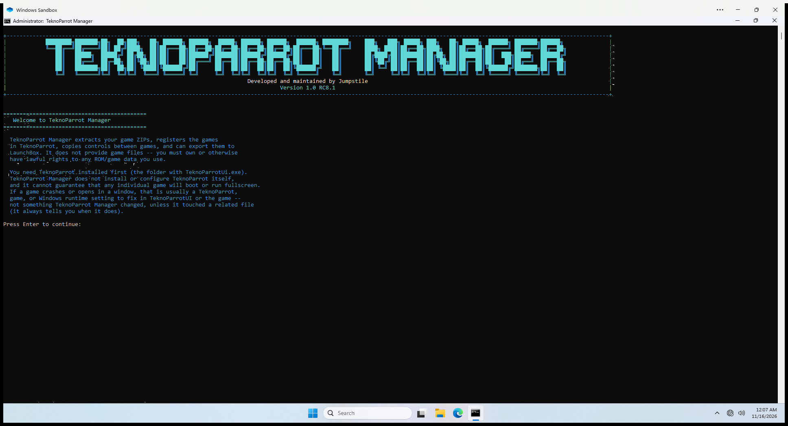

You do not need an Administrator PowerShell window. TeknoParrot Manager asks Windows for permission if a supported setup step needs it.

Stuck? See [PowerShell is blocked](TROUBLESHOOTING.md#7-powershell-is-blocked).

## 5. Answer TeknoParrot Manager's first-run questions

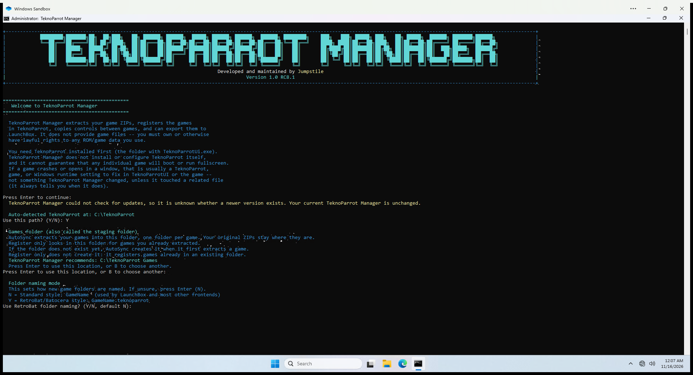

TeknoParrot Manager asks a few questions the first time. Your answers are saved, so you do not answer them again.

A [staging folder](#staging-folder) is simply your extracted-games folder. It must be a separate folder. It must not contain TeknoParrot, TeknoParrot Manager, or your ZIP folders.

Type each answer, then press **Enter**.

1. First time only: on the welcome screen, press **Enter** at **Press Enter to continue**.

   You will see: the next setup question.

   Next: if you see **TeknoParrot Manager found your saved settings.**, go to step 2. If not, go to step 5.

2. Look at the saved-settings question: **Use these settings? (Y/N, D = show them)**.

   You will see: the line **TeknoParrot Manager found your saved settings.** and then this question. The list of settings is not printed on its own.

   Next: type **D** to look at your saved settings (step 3), or go straight to step 4.

3. Type **D** and press **Enter**.

   You will see: your saved settings, one per line, with the folder paths. Then the same question again.

   Next: decide if the settings are correct.

4. Type **Y** if the saved folders are correct. Type **N** if they are not.

   If you press only **Enter**, you will see **Please choose Y or N.** and the question again.

   You will see after **Y**: **Using your saved settings.** TeknoParrot Manager does not ask for your folders again.

   You will see after **N**: the folder questions below. Nothing is deleted. Your new answers replace the old ones later.

   Next: after **Y**, start-up carries on and the main menu appears. After **N**, go to step 5.

5. If you see **Auto-detected TeknoParrot at:**, check the folder shown. At **Use this path? (Y/N)**, type **Y** only if that folder contains your `TeknoParrotUi.exe`.

   You will see after **Y**: your chosen TeknoParrot folder, then the games-folder question.

   Next: after **Y**, go to step 8. After **N**, go to step 7.

6. If you see **Found TeknoParrot in multiple locations:**, type the number of the folder that holds your `TeknoParrotUi.exe`.

   You will see: your chosen TeknoParrot folder, then the games-folder question.

   Next: go to step 8.

7. If none of the detected folders is correct, choose **N**. Then type the folder path, type **B** to browse for it, or type **Q** to quit. Nothing is changed if you quit.

   You will see: the prompt **Type the path of your TeknoParrot folder, the one with TeknoParrotUi.exe in it, or Q to quit (or type B to browse)**, then the games-folder question.

   If you close the browse window without choosing, the question comes back. If the folder does not exist, you see **That folder does not exist. Check the spelling, or type B to browse.** If it has no `TeknoParrotUi.exe`, you see **TeknoParrotUi.exe is not in that folder. Pick the folder that has TeknoParrotUi.exe in it.** Choose again.

   Next: go to step 8.

8. At **Games folder (also called the staging folder)**, choose the folder that holds your games.

   AutoSync extracts games into it, one folder per game, and leaves your original ZIPs where they are. Register only looks there for games you already extracted.

   You will see: the selected folder accepted, or a reason to choose a different one.

   Next: if your games are already extracted, go to step 9. If you will use AutoSync, go to step 10.

9. For games you already extracted: type **B** and select the folder that holds each game's own folder.

   You will see: the folder accepted.

   Next: go to step 11.

10. For AutoSync: press **Enter** to accept the recommended folder if it suits you.

    You will see: the folder accepted.

    Next: go to step 11.

11. At **Use RetroBat folder naming? (Y/N, default N)**, press **Enter** for ordinary folder names.

    Choose **Y** only if you use RetroBat or Batocera. Then `.teknoparrot` is added to new extracted folder names.

    You will see: the DAT question, or the next configuration message.

    Next: answer the DAT question.

12. At **Choice (D/B/N, default D)** for the optional DAT, press **Enter** to download the index.

    The DAT holds names used to match games, not games themselves. Choose **B** for a ZIP or `.dat` file you already have. Choose **N** to skip. Do not choose a game ZIP as the DAT.

    You will see: the download or import result, or setup continuing without the DAT.

    Next: answer any question about start-up files (step 13).

13. If TeknoParrot Manager says it found its own state files (its own working files) outside the managed data folders and lists `TeknoParrot-Manager.log`, answer **Y** or **N**.

    That file is only its own start-up log. **Y** moves it into TeknoParrot Manager's managed `Logs` folder. **N** changes nothing and leaves it where it is. Either answer is safe.

    You will see: the main menu.

    Next: your choices are saved. Go to section 6.

Your choices are saved and written to the log file. TeknoParrot Manager does not print them again. To check them later, type **D** at **Use these settings? (Y/N, D = show them)** the next time you start.

A save warning means your choices will not be remembered.

Stuck? See [Nothing found](TROUBLESHOOTING.md#1-nothing-is-found) or [Network drive](TROUBLESHOOTING.md#9-a-network-drive-is-unavailable).

### More detail

- The settings list that **D** shows includes, for example, TeknoParrot root, ZIP source folder, and Games install folder. A row appears only if that setting is saved.
- Letters are not case sensitive, and extra spaces are ignored.
- If TeknoParrot Manager has no saved settings yet, it shows the welcome screen and does not ask the saved-settings question.
- On a first run, if you type a TeknoParrot folder that already holds saved settings, the same question **Use these settings? (Y/N, D = show them)** is asked after you choose the folder.
- With unattended mode, TeknoParrot Manager prints **TeknoParrot Manager found your saved settings.** and then **[Unattended] Using saved settings.** without a question.
- If the saved file is empty or damaged, you see **WARNING: Saved configuration could not be read (file may be corrupt).** and the first-time questions follow.
- A staging folder for Register only is the existing parent folder that contains each game's own folder. For AutoSync, it is where games will be extracted; it can be new.
- The normal DAT download uses `%LOCALAPPDATA%\TeknoParrotManager\Eggman`. It is separate from game ZIP sources and from TeknoParrotUI's own DAT/XML settings.
- If the DAT download fails, select an existing index or press **Enter** to skip.

## 6. Register your first game

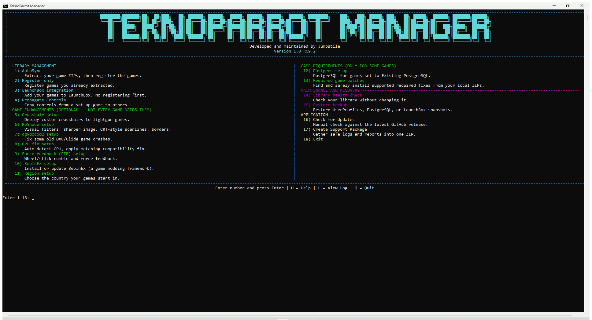

[Registration](#registration) tells TeknoParrot where your game is. It adds the game's settings file and its executable path to TeknoParrot.

Registration does not prove that the game launches or that its controls work.

Pick the route that matches your game. Use route A if the game is already extracted. Use route B if it is still in a ZIP.

### A. Your game is already extracted

1. Type **2** at the main menu to choose **2) Register only**.

   You will see: the preview question or a folder check.

   Next: if you see `The games folder TeknoParrot Manager recommended does not exist yet.`, go to step 2. If not, go to step 3.

   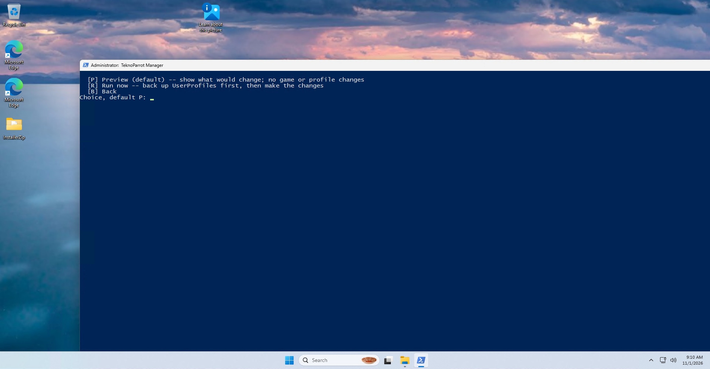

2. Type **R**, then type or browse to the folder where your games are already extracted.

   You will see: the preview question.

   Next: go to step 3.

3. Press **Enter** at **Choice, default P** to choose **P**, preview only.

   You will see: the planned registration work. No game or setup files are changed. The preview is still written to the log.

   Next: read the matches.

4. Read the proposed matches. Do not approve a wrong match.

   You will see: matching games, choices left open, or a reason nothing can be added.

   Next: go to step 5.

5. At the end of the preview, choose **Y** (apply changes) only if the preview is correct. Choose **N** to return to the menu.

   TeknoParrot Manager scans again before it writes anything.

   You will see: the real registration result, not just preview counts.

   Next: go to "Finish either route" below.

### B. Your game is still in a ZIP

1. Type **1** to choose **1) AutoSync**.

   You will see: **P** preview (default), **R** run now, and **B** back.

   Next: press **Enter** for the default.

2. Press **Enter** for the default **P** to preview first.

   You will see: the source-folder questions if no ZIP source has been saved, or the next folder check.

   Next: choose the folder that holds your ZIPs.

3. Select the folder that directly holds your own game ZIPs. Use **B** to browse when offered.

   You will see: the selected source path and any next source question.

   Next: skip the second source.

4. Press **Enter** to skip the optional second source, unless you already use one.

   You will see: the game selection list or the next folder check. Answer any folder-safety warning before you continue.

   Next: browse the games.

5. Type **L** to browse the games not yet extracted.

   You will see: a numbered game list.

   Next: pick one game.

6. Type the number of one game to add it to the selection.

   You will see: that game in your selected queue.

   Next: finish selecting.

7. Type **D** to finish selecting. (Here **D** means "done".)

   You will see: the planned extraction and registration work. In preview, no extraction happens and no [backup](#backup) of your game settings (UserProfiles) is made.

   Next: check the preview.

8. At the end of the preview, choose **Y** (apply changes) only if the game and paths are correct.

   You will see: a fresh scan and selection before the real run. TeknoParrot Manager does not blindly apply preview results.

   Next: pick the game again.

9. Select the same one game again if the picker reappears.

   You will see: backup, extraction, and registration results. A failed backup stops extraction.

   Next: answer any "New game only" question.

10. If asked **New game only / Check all games / Back**, press **Enter** for **N**, new game only.

    You will see: the registration result and a return to the menu, without whole-library maintenance.

    Next: go to "Finish either route" below.

AutoSync does not extract `.rar` or `.7z` game archives. Extract those yourself first, then use Register only. AutoSync tells you when it skips one.

Keep the original game files and ZIPs. Never delete leftover marker files just to clear an error.

### Finish either route

1. If TeknoParrot Manager offers a choice for an uncertain game match, select only a candidate you can identify. Otherwise leave it unresolved.

   You will see: that game's checked result, or an item left for manual attention.

   You may also be asked `Which country do you want your games to start in?` This is Region setup. Type **0** to leave every game as it is. You can set it later with **11) Region setup**.

   Next: answer the next question.

2. If asked to repair broken paths on this first run, choose **N** unless you need to fix an existing registration.

   You will see: the next question, without a repair.

   Next: answer the thumbnails question.

3. If asked about thumbnails, choose **N** to skip optional icons for now.

   You will see: the next workflow step. Missing icons do not mean an unsupported game.

   Next: answer the controls question.

4. If asked about copying controls before you have set up a reference game, choose **N**. If it offers a device survey instead, answer for the devices you use.

   You will see: a binding plan or the next step. It does not claim that all controls work.

   Next: leave LaunchBox for now.

5. Choose **B** at the optional [LaunchBox](#launchbox) menu for now.

   You will see: TeknoParrot Manager continuing without changing LaunchBox. The AutoSync new-game-only route may return before this menu.

   Next: skip the other optional setups.

6. If offered an optional second DAT, crosshairs, ReShade, dgVoodoo2, GPU fixes, CPS3 first-boot files, or System 11 saved game files, choose **N**. Do that setup later, after the game has been tested.

   You will see: the next step, without that optional setup.

   Next: read the result message.

7. Read **ACTION REQUIRED** and the result message.

   You will see: anything still needing setup, including unmatched games or controls to configure. A preview or a partial result is not a successful registration.

   Next: open TeknoParrotUi.exe to check.

   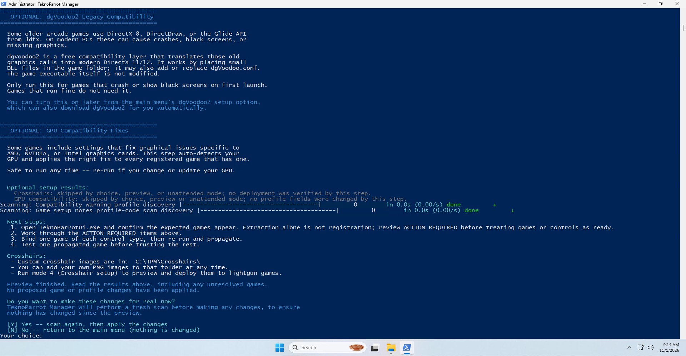

8. Open **TeknoParrotUi.exe** yourself.

   You will see: your successfully registered game in TeknoParrot's list. If it is not there, use Troubleshooting. Do not assume it was added.

   Next: go to section 7.

Stuck? See [Game not matched](TROUBLESHOOTING.md#2-a-game-is-not-matched).

### More detail

- Preview mode writes no game changes, but logging still occurs.
- Before its first real write, Register makes a safety backup of your game settings (UserProfiles). AutoSync backs up before extraction on a real run. Preview skips these backups.
- When a game folder already exists, AutoSync leaves it alone if its ZIP did not change, so your saves and settings stay. If a changed ZIP replaces a folder, extra or different files in it (saves, settings, ReShade files) are first copied to `Backups\AutoSyncReplaced`. If they cannot be saved, or no Backups folder is set up, that game is not updated and nothing is changed for it.
- A matching game means TeknoParrot Manager found a ready-made setup file in `GameProfiles` for it.
- "Whole-library maintenance" means the **Check all games** choice. It is not needed for one new game.

## 7. Make one game work well, then copy what is safe

Do these steps in order. Test after each change, so you know which change helped.

1. In TeknoParrotUI, select your first game.

   You will see: that game's settings and launch actions.

   Next: open the controls.

2. Open **CONTROLLER SETUP** (the legacy guide's label).

   You will see: the actions that game needs you to bind.

   Next: bind each one.

3. Bind each needed button or axis. Select its field, then press the key, button, wheel, pedal, or gun input you want. Include Coin, Start, Test, and Service where present.

   You will see: values assigned to those fields.

   Next: save.

4. Save the game's control settings.

   You will see: the saved game screen. Reopen the controls if you need to check a binding.

   Next: test the game.

5. Choose **PLAY** in TeknoParrotUI and test starting and controlling the game.

   You will see: a playable game with working controls, or a specific error to troubleshoot.

   Next: close the game.

6. Close the game and TeknoParrotUI before returning to TeknoParrot Manager.

   You will see: both are closed. It is safe to change game settings now.

   Next: copy controls only after you have bound one game of each type you use (buttons, driving, lightgun, or trackball).

   Use RetroBat? A game that works from TeknoParrot can still fail when RetroBat starts it, because they are two different ways to start a game. See "A game works in TeknoParrot but not from RetroBat" in docs/TROUBLESHOOTING.md. TeknoParrot Manager does not change RetroBat.

7. In TeknoParrot Manager, choose **4) Propagate Controls**. ("Propagate" means copy to your other games.)

   You will see: how many games have their controls set up, and the question `Copy controls from N games to your other games of the same type? (Y/N, D = details)`.

   Next: press **D** to see each example game and the settings it will copy.

8. Approve copying only if the displayed reference settings suit your hardware.

   You will see: the copy result and any controls left for manual setup. Existing button bindings are kept, but the input-system setting may change.

   If a game type has no usable example, its games are skipped. The run can finish with a skipped count. Details and the log list those games, and name one game of each type to set up first in TeknoParrotUI. Set up that game with your own controls, then run this again. Choosing a device in a binding plan does not set up a game. If all games are skipped, no game was changed. A failed save still ends as an error. A finished run does not prove the controls work.

   Next: test one game.

9. Launch one updated game to test its controls before trusting the others.

   You will see: whether the copied controls really work in that game. Registration and copied bindings alone do not prove them.

   Next: add extras only if you need them (below).

Extras, only if needed:

- GPU compatibility: choose **8) GPU fix setup** for the supported fixes for your graphics card (GPU). Read the result, then test the affected game. A fix is not available for every game or GPU.
- Lightgun crosshairs: choose **5) Crosshair setup** if you want different aiming images. Follow the preview to pick player 1 and player 2 images, then approve deployment. Test aiming in-game. Images do not calibrate a gun.
- Required fix: choose **13) Required game patches** only for a covered build, as explained in section 8.
- dgVoodoo2: choose **7) dgVoodoo2 setup** only when an older game crashes or has a graphics problem that its documentation names. It is not a universal crash fix.
- ReShade: choose **6) ReShade setup** only if you want optional visual effects after the game works.
- Force feedback (FFB): choose **9) Force feedback setup** only for supported wheel or controller feedback.
- Region: choose **11) Region setup** if you want your games to start in a country such as USA or Europe. Pick a country, pick all games or some, then type **Y** to confirm. A restore point is saved first. Only countries a game really offers are used. Details are in the Region Setup part of the [User Guide](../TeknoParrot-Manager-User-Guide.pdf).

Do not apply unrelated fixes all at once.

Stuck? Start with [Troubleshooting](TROUBLESHOOTING.md), the game's official compatibility information, and the `TeknoParrot-Manager-game-notes.txt` documentation report. Some games require additional setup. TeknoParrot Manager does not guarantee boot, fullscreen, or complete controls.

### More detail

- Native FFB Blaster needs paid TeknoParrot membership. The third-party plugin has different coverage.
- For laptops with two GPUs, the official legacy guide also recommends selecting the dedicated GPU for the game's process. That is a Windows or driver setting, not the same as TeknoParrot Manager's GPU fix.
- See the [official guide](https://teknoparrot.com/wiki/getstarted.html) for game-specific guidance, including BudgieLoader for Lindbergh/Linux games.
- ReShade, change the look at any time: choose **6) ReShade setup** again. Every change can be undone, for all games or for one game (see "undo" below).
- ReShade, change the look for all games: choose **6) ReShade setup**, then **S**. Pick the new look, choose **[U]** to use it, then **[Y]** to confirm. Then choose **A) All** registered games and **[Y] Yes**.
- ReShade, change the look for one game: follow the same steps, but choose **L) Browse and select specific games**. Type that game's number, then type **D** (here **D** means "done").
- ReShade, undo: choose **6**, then **U) Undo ReShade changes**. The games are listed newest first. Pick one game's number and type **YES**, or choose **[A] Undo all** and type **ALL**. Any other answer cancels, and nothing is changed.
- ReShade, bezels: the first screen of menu 6 has four choices: **S**, **R**, **U** and **B) Use my bezel folder (bezels you already have)**. A bezel is a picture that frames the game on a wide screen. Choose **B**, then **F** to pick a folder of your own `.png` bezels. You see a preview first (`Bezel preview. Nothing has been changed yet.`) and nothing is downloaded. A game needs ReShade first. A game that shares its folder with other games is skipped, and a bezel you placed yourself is kept unless you say yes to replacing it. To undo, choose **6**, **B**, then **U**.
- ReShade works with both 32-bit and 64-bit games. Games that run through BudgieLoader (a Linux-style game format) are skipped for now, and nothing in their folder changes.
- ReShade shows no welcome window, counters or messages when a game starts, and the key that opens it still works. A short ReShade version banner may still show for a moment at game start. ReShade has no setting to hide it.
- After ReShade is applied, the result screen says `To turn the effect on or off, start a game and press the Home key.` It also says `Next: You can undo this in ReShade > Undo ReShade changes.`
- If some games already have ReShade files that TeknoParrot Manager did not install, they are listed under `Not changed:` and left alone. You may then see the choices **A**, **S**, **B** and **D**.
- If a game already uses TeknoParrot's own CRT look, ReShade setup can ask what to do, because both together can look doubled. Choose **K** to keep it (default). Choose **T** to turn it off, only for the games that get ReShade now. A saved copy of your game settings is made first. To put it back, use ReShade > Undo ReShade changes, or main menu **15) Restore backup**.
- On ReShade result screens the choices include **[D] Details**, for example **Press A, S, B or D** or **Press D for details, or Enter to return to the menu**. Type **D** and press **Enter** to see the full technical information. It is also kept in the log.
- PostgreSQL setup (main menu **12) Postgres setup**): the result screen is short. It ends with **Press Enter to return to menu, or D for details**. Type **D** and press **Enter** for the details, or just **Enter** to return.
- Library health check (main menu **14**) also checks every game database. A database that is not ready shows as `Problem - <game>`. Run **12) Postgres setup** to fix it. A game set to Internal storage needs no database install. It shows as `Game database: OK`, and you start the game once so it makes its own database.
- The health check also names games with a game type it does not know, games TeknoParrot has not released yet (`not available yet`), emulators missing from your TeknoParrot folder, and games that need you to pick the game file by hand in TeknoParrotUI. Press **D** for the list.
- Every game database is tested with the game's own settings before setup says the game is ready. A game with no starting database file (`pg_backup`) is `Profile ready` when TeknoParrot creates its database itself (Golden Tee Live 2018 and newer, Golden Tee PGA Tour): start the game once. Any other game with none is left out and named as not ready.

## 8. Required game patches: menu 13

This menu fixes known problems in certain game builds. It uses ZIP files you already have. It does not get patch files for you.

Before it changes anything, it:

- checks the game build and the expected files;
- backs up the changes;
- offers undo for the changes it recorded.

Unknown files and different builds are left alone.

Choose one letter at the menu:

- **A** checks your registered games (automatic mode).
- **M** applies one supported fix to an installed game folder (manual mode). It does not register that game.
- **U** undoes a fix.
- **Q** returns to the menu.

Read the proposed fix. Confirm only if it is for your copy of the game.

If a game still has a problem after the patch, the patch result does not prove the game launches, controls work, or it is ready to play.

Stuck? Keep the message, your own ZIPs, and any backup or receipt paths shown. Ask for help instead of renaming files to force a match.

### More detail

- Automatic mode checks registered games. Manual mode lets you select an installed game folder but does not register it.
- Undo also refuses to overwrite files changed since TeknoParrot Manager wrote them.
- In manual mode (M), TeknoParrot Manager lists each game once (for example `Hummer Extreme Edition (14 patches)`) and you type its number. It asks for the game's folder once. Choosing a folder does not register or change the game. It asks you again before applying any patch.
- If none of your registered games has a patch in this list, TeknoParrot Manager says `None of your registered games has a patch in this list. Nothing was changed.` If a game is installed but not registered, use M.
- If a check blocks a fix, it says `Nothing was installed. Fix the problem above, then try again.` The reason is above that line in plain words. That line is not shown when everything was already installed.
- Games that were already installed are listed as `Already installed, nothing to do` and need no action.
- Press **D** at the last question for the technical details: patch names, exact reason, result codes, and the folder with your undo copy.
- Your build may not be covered. Neither message proves the game needs no fixes.
- Patch success does not prove launch, controls, or gameplay readiness.

## 9. LaunchBox is optional

[LaunchBox](#launchbox) is a separate app for browsing your games. You do not need it to launch a game in TeknoParrotUI.

TeknoParrot Manager works with a LaunchBox you already have. It does not install LaunchBox.

1. Close LaunchBox and BigBox. Save any work first.

   You will see: neither app running.

   Next: go to the LaunchBox menu.

2. After a normal interactive registration run, find TeknoParrot Manager's LaunchBox action menu. Choose **P** to preview.

   You will see: a folder question, or the proposed integration settings. Your library is not changed.

   Next: choose the folder.

3. Select the LaunchBox installation folder when asked.

   You will see: the platform choices.

   Next: choose a platform.

4. Choose **2** for a separate TeknoParrot platform. You can choose Arcade (**1**) or both (**3**) instead.

   You will see: the planned additions to those platforms. Preview does not offer a custom platform.

   Next: when the preview is right, apply it.

5. Choose **A** from the LaunchBox action menu when the preview is correct.

   You will see: a backup-first confirmation. **B** skips instead. **F** creates a manual-import reference file without writing the library.

   Next: confirm with LaunchBox closed.

6. Answer **Y** to continue, only with LaunchBox and BigBox still closed.

   You will see: the folder and platform questions again, with your previewed choices offered as defaults when available. **4** now allows a custom platform name.

   Next: confirm the folder and platform.

7. Confirm the folder and platform choices.

   You will see: an exact plan and, if changes are needed, the final write confirmation.

   Next: read the plan carefully.

8. Answer **Y** to **Write exactly these changes after a verified backup? (Y/N)**, only if the plan is correct.

   You will see: the actual integration result and backup details, or a failure or partial result to fix.

   Next: open LaunchBox.

9. Open LaunchBox after TeknoParrot Manager finishes.

   You will see: successfully added games in the chosen platform. Use LaunchBox's own metadata and art tools if you like.

   Next: you are done with this section.

Stuck? See [LaunchBox is open](TROUBLESHOOTING.md#5-launchbox-or-bigbox-is-open).

### More detail

- If you took AutoSync's new-game-only shortcut and no LaunchBox menu appeared, a normal Register-only run can reach the optional menu.
- Do not choose whole-library maintenance just to get past a missing menu without reviewing its scope.
- The LaunchBox menu has more choices than the steps above use: **G** fills in game details and makes playlists, **V** groups regions and versions of a game into one game with a version picker, **S** keeps LaunchBox in step with TeknoParrot (removed and moved games), and **L** links games for art and details. Each one shows a preview, makes a backup first, and asks before it saves.
- A game you add gets its real game name (for example "Too Spicy", not "2Spicy"). A game is linked by itself only when TeknoParrot Manager is sure it is the same game. When it is not sure, you pick from the possible games.
- A game that cannot start yet (its game file, firmware or BepInEx is missing) gets a `Needs setup` note and goes into a `Needs setup` playlist. Both go away by themselves when the problem is fixed.

## 10. Read progress, find logs, and keep backups

A progress bar shows work being done. `3/40` means three items are finished.

Some work has no known total, so its bar moves without a percentage.

Always read the result after the bar. A full bar does not prove the files were checked or that a game works.

Where things are saved:

- Saved copies of your game settings: `<TeknoParrotFolder>\UserProfiles\FullBackup\<date_time>\`.
- Normal log: `<TeknoParrotFolder>\TeknoParrotManager\Logs\TeknoParrot-Manager.log`.
- Reports: `<TeknoParrotFolder>\TeknoParrotManager\Reports\`.
- Support: choose **17) Create Support Package** to collect diagnostics, not game files. Preserve any failure evidence and review the package before sharing it.

`<TeknoParrotFolder>` means the folder you selected, not text to type literally.

The normal saved copy covers only your game settings (UserProfiles). It does not copy game folders, game-side saved machine state (NVRAM), test-menu settings, or calibration files stored outside UserProfiles. Back up those files separately before changing them.

Each time TeknoParrot Manager starts, it saves a checked restore point of your game settings and its own settings, but only when something changed since the last one. It never removes older restore points by itself. You can use them in **15) Restore backup**, option 4.

To get your settings back, use [Restore a backup](TROUBLESHOOTING.md#10-restore-a-backup).

### More detail

- A required backup failure stops changes.
- AutoSync backs up before extraction on a real run. Register makes a safety backup before its first real game-settings write. Preview skips these backups.
- Early start-up may log beside the TeknoParrot Manager script before the TeknoParrot folder is known.
- Reports include `TeknoParrot-Manager-ActionItems.txt`, `TeknoParrot-Manager-controls.txt`, and game notes. ACTION REQUIRED may be saved elsewhere if you choose another path.
- Optional LaunchBox, database, and patch operations have their own scoped backups. None is a whole-game backup. See [issue 378](https://github.com/Jumpstile/teknoparrot-manager/issues/378).

## Glossary

### Profile

A profile (a game setup file) is a game's settings template in `GameProfiles`, or your configured copy of it in UserProfiles.

### UserProfiles

UserProfiles is the folder inside TeknoParrot that holds your registered games' executable paths, controls, and per-game settings as XML files.

### DAT

A DAT is an optional community list of game names. It helps TeknoParrot Manager match your files to the correct TeknoParrot game setup file. It contains no games.

### Staging folder

The staging folder is the separate games folder where AutoSync extracts your ZIPs, or where Register only looks for games already extracted.

### Registration

Registration means creating or checking the game's UserProfiles entry with the path to its executable. It does not prove the game works.

### LaunchBox

LaunchBox is an optional separate app for browsing and launching games from one library.

### Backup

A backup is a saved copy of the particular files an operation protects. It is not a copy of every game or all of its saved state.
